# Weather sensor metrics service

A small service that collects readings from weather sensors (temperature, humidity, wind speed, ...)
and answers questions about them, such as *"what was the average temperature and humidity at
sensor 1 last week?"*. It offers a REST API, a simple web page to explore the data, and a test suite
that defines how the API behaves.

**Approach in short**

- Kept intentionally minimal: one stateless API service and one Postgres database. Every reading
  is committed before it is acknowledged, and retries are harmless.
- Load tested to know where that setup runs out, so scaling can follow adoption: what to watch, and
  what to add at each limit, is in [architecture.md](docs/architecture.md#scaling-with-adoption).



## Quick start

Requirements: Docker with Compose; [uv](https://docs.astral.sh/uv/) for tests and tooling.

```bash
docker compose up --build -d     # starts the database and the API on http://localhost:8000
make seed                        # optional: 30 days of synthetic data for 10 sensors
```

- Web page: http://localhost:8000
- API documentation: http://localhost:8000/docs
- Stop: `docker compose down` (add `-v` to delete the data)
- The web page lists sensors that reported in the last 24 hours; if it is empty, run `make seed` again.

Port 8000 already taken? Start it on another one: `API_PORT=8001 docker compose up --build -d`.

## Using the API

Send readings: a batch of measurements, each with one or more metrics.

```bash
curl -s -X POST localhost:8000/api/v1/readings -H 'content-type: application/json' -d '{
  "readings": [
    {"sensor_id": "sensor-1", "metrics": {"temperature": 21.3, "humidity": 40}}
  ]}'
# → {"inserted": 2, "duplicates": 0}
```

Ask a question: the average temperature and humidity for sensor-1 over the last 24 hours.

```bash
curl -s "localhost:8000/api/v1/stats?sensor_id=sensor-1&metric=temperature&metric=humidity&stat=avg"
# → {"stat": "avg", "start": "...", "end": "...",
#    "results": [{"sensor_id": "sensor-1", "metric": "humidity", "value": 40.0, "count": 1}, ...]}
```

| Endpoint | What it does |
|---|---|
| `POST /api/v1/readings` | Store up to 1000 readings per request |
| `GET /api/v1/stats` | Min, max, sum or average of chosen metrics for some or all sensors over 1 to 31 days (default: the last 24 hours) |
| `GET /api/v1/sensors` | Sensors and metrics that reported in the last 24 hours |
| `GET /health`, `GET /ready` | Is the service up; can it reach the database |

A few rules worth knowing:

- Sensors and metrics need no registration; they appear with their first reading.
- Timestamps need a timezone. Without a timestamp, a reading is stored at the time it arrives.
- A query covers 1 to 31 days. Leave out the dates to get the last 24 hours.
- Unknown sensors or empty periods return an empty result, not an error.

Assumptions and key decisions are in [docs/architecture.md](docs/architecture.md#assumptions).

## Tests

```bash
uv sync
make test                                        # unit tests
make test-integration                            # database behaviour, real Postgres (needs Docker)

# API contract tests, run against a separate throwaway stack
API_PORT=8010 docker compose -p bbtest up --build -d
API_BASE_URL=http://localhost:8010 make test-blackbox
docker compose -p bbtest down -v
```

The contract tests talk to the API over HTTP only, so they check behaviour rather than
implementation. Linting, type checks and unit tests also run as pre-commit hooks
(`uv run pre-commit install`).

## Documentation

- [Architecture](docs/architecture.md): assumptions, decisions and why, limits and next steps
- [Performance](docs/performance.md): load tests and what one API pod can handle

## Project layout

```
app/       the API (FastAPI)
alembic/   database migrations
static/    the web page
scripts/   synthetic data generator
tests/     unit, integration (real Postgres) and contract (blackbox/) tests
perf/      load test scripts
docs/      architecture, performance, diagram
```
