# Architecture

A deliberately minimal baseline: one stateless API service backed by a single Postgres database,
enough for early usage. The load tests ([performance.md](performance.md)) measure where this setup
runs out, and the table below maps each limit to the next step as traffic grows.

## Assumptions

- Sensors and metrics need no registration; they appear with their first reading.
- Timestamps carry a timezone; a reading without a timestamp is stored at arrival time.
- A query covers 1 to 31 days and defaults to the last 24 hours. Results are per sensor and metric.
- The same sensor, metric and timestamp is a retry: the first write wins.
- No authentication yet.

## Key decisions

- **Acknowledge only after the database commit,** and make retries harmless, so no reading is lost
  or counted twice.
- **No queue in front of the database.** One Postgres handles the expected load; a queue would be
  one more system to run before it is needed.
- **Fail fast under overload** with a `503` instead of letting requests pile up. Clients can retry
  safely.

## Scaling with adoption

In production the API would export metrics (Prometheus or OpenTelemetry): request rate and latency
per endpoint, `503` rate, connection pool wait, and database CPU. Those tell us which limit is
coming, before users notice.

| Signal | Measured limit (one 2 CPU pod) | Action |
|---|---|---|
| API CPU high, latency rising on small requests | ~750 req/s | Add API replicas |
| Long all-sensor queries slow or returning `503` | ~2 req/s for 30 days (10 sensors) | Hourly rollups |
| Ingest rows/s close to the limit | ~2.3k rows/s unbatched, ~100k rows/s batched | Batch on the client, then a durable log in front of Postgres |
| Database connections close to the maximum | ~3 pods | Connection pooler |
| Data kept beyond a few months | not measured | Index on `ts`, time partitioning |

## Known gaps

- The web page lists sensors that reported in the last 24 hours, so it is empty on old data.
- No authentication, rate limits or production metrics yet.
