# Design

How the service is built and why. The original plan and assumptions are in [plan.md](plan.md);
measurements are in [performance.md](performance.md).



## Principles

- **Minimal, stable, robust.** Scale and workload profile (ingest- vs query-heavy) are unknown, so
  the simplest correct design was built and both paths were measured. Optimizations are listed
  under [next steps](#next-steps), each tied to what would trigger it.
- **Durable before acknowledged.** A write is acknowledged only after the database commit.
- **Idempotent ingest.** Clients retry; a duplicate reading is a no-op.

## Data model

One narrow table:

```sql
CREATE TABLE readings (
    sensor_id  text             NOT NULL,
    metric     text             NOT NULL,
    ts         timestamptz      NOT NULL,
    value      double precision NOT NULL,
    PRIMARY KEY (sensor_id, metric, ts)
);
```

- The primary key gives idempotent ingest (`ON CONFLICT DO NOTHING`) and is the index every query
  uses (`sensor_id IN … AND metric IN … AND ts >= start AND ts < end`).
- A new metric needs no migration.
- Plain Postgres, unpartitioned. Partitioning would not speed up these queries (they read the same
  rows); it pays off for retention and index size at volume. TimescaleDB is one
  `create_hypertable(..., migrate_data => true)` migration away, with no application changes.

## Write path

- `POST /api/v1/readings` takes 1–1000 readings (max 10,000 metric points), validates them
  (timezone-aware timestamps, not more than 5 minutes in the future, not before 1970, finite values,
  name patterns), and writes them in **one statement**:
  `INSERT ... SELECT FROM unnest(...) ON CONFLICT DO NOTHING`.
- Four array parameters instead of a multi-row `VALUES`: asyncpg caps a statement at 32,767 bind
  arguments, which 10,000 points × 4 columns would exceed.
- Points are sorted by `(sensor_id, metric, ts)` first, so concurrent overlapping batches take locks
  in the same order and cannot deadlock. Within a batch the first occurrence of a key wins.
- `inserted` is the row count; `duplicates` is the remainder (stored or within the batch).
- **Commit before ack.** FastAPI's default `yield`-dependency scope ("request") runs its exit code
  after the response is sent, which would commit *after* the 201. The connection dependency uses
  `scope="function"`, so the transaction commits before the response; a unit test asserts the
  declaration, and the black-box suite checks the behavior.

## Read path

- `GET /api/v1/stats`: range resolution is a pure function (`app/ranges.py`): half-open
  `[start, end)`, 24 hours to 31 days, defaults to the last 24 hours, 422 when out of bounds (never
  clamped). Then one `GROUP BY sensor_id, metric` with the aggregate picked from a fixed mapping.
- Reads use a connection in autocommit mode: no `BEGIN`/`COMMIT` round trips for pure reads.
- `GET /api/v1/sensors` lists `(sensor_id, metric)` pairs seen in the last 24 hours, which keeps it
  bounded; a catalog table would replace it if it got slow.

## Async and processes

- All endpoints are `async def` and every database call is awaited (SQLAlchemy 2 Core on asyncpg).
  No blocking I/O runs on the event loop.
- CPU parallelism comes from processes: `fastapi run --workers N`, one connection pool per worker,
  sized so `workers × (pool_size + max_overflow)` stays below Postgres `max_connections`.
- Validating and sorting a 10,000-point batch is CPU work on the event loop; async cannot help with
  that, more workers do. The load test shows it: small-batch ingest is API-bound and scales with
  workers.
- Migrations run once in a separate `migrate` Compose service before the API starts, never inside
  the N workers.

## Database guardrails

Postgres enforces limits on every API connection (set through asyncpg `server_settings`,
configurable via env):

| Setting | Default | Why |
|---|---|---|
| `statement_timeout` | 5 s | A runaway query is cancelled by Postgres and frees its pooled connection, even if the client has gone. |
| `lock_timeout` | 2 s | A write waiting on a lock fails fast instead of piling up requests. |
| `idle_in_transaction_session_timeout` | 10 s | A transaction left open by a bug cannot hold locks indefinitely. |
| pool timeout | 5 s | Waiting for a free pooled connection is bounded. |

These are chosen defaults, kept as named constants in `app/db.py`, not environment settings; the
only runtime setting is `DATABASE_URL`. API connections also report `application_name=sensor-api`,
so they are easy to find in `pg_stat_activity`.

A cancelled query (`503 "query timed out"`), a lock timeout (`503 "database busy"`), an exhausted
pool and an unreachable database (`503 "database unavailable"`) all return `503`; validation
problems return `422`; anything else returns a generic `500` and is logged.
Migrations use their own engine without these timeouts, so they can legitimately run long.

The guardrails trade completeness for stability: an all-sensor 30-day query over 100 sensors
(measured at 12 s) now fails fast with a 503 instead of occupying a connection. Rollups (below)
are what make such queries fast.

## Error handling

| Situation | Status |
|---|---|
| Invalid input, range out of bounds, numeric overflow (`22xxx`) | 422, with field-level details; inputs are echoed only if small and JSON-safe |
| Database unreachable, pool exhausted, query cancelled by timeout, lock timeout | 503 |
| Anything else | 500 with a generic body; the exception is logged |

The mapping is the pure function `classify_db_error`; integration tests (`tests/integration`) feed it
real exceptions from a Postgres container.

## API and worker separation

There is one process type, the API. A separate worker process (for example the API/worker split
with a task queue or Temporal) is the right tool for long-running, retried background work; this
service has none: ingest is one `INSERT`, a query is one `SELECT`.

Putting a queue between the API and the database would also change what a `201` promises: the API
would acknowledge after enqueueing, not after committing, so the queue must be durable for the
acknowledgement to mean anything. That is worth it once a workload calls for it:

- **Ingest-heavy**: API → durable log (Kafka / Kinesis) → writer workers using `COPY`. This is
  the API/worker split with the log as the hand-off, and the path past the ~120k rows/s that a
  single Postgres reached in the load test.
- **Query-heavy**: a scheduled rollup worker maintaining hourly aggregates; the first worker to add,
  since long-range all-sensor queries are the clearest gap in the measurements.
- **Contention between paths**: before any queue, deploy the same image twice, as an ingest API and
  a query API, and scale them separately.

## Next steps

- **Query-heavy:** hourly min/max/sum/count rollups (rollup table or TimescaleDB continuous
  aggregates; avg = sum / count): a 30-day query reads ~720 rows per sensor and metric instead of
  ~43k. Then read replicas and caching of hot windows.
- **Ingest-heavy:** client-side batching first (batch 500 gives ~25–50× the rows/s of batch 1), then
  a durable log and `COPY` writers, then sharding by `sensor_id`.
- **Volume and retention:** time partitioning (native partitions with `pg_partman`, or TimescaleDB)
  and compression.
- **Reliability and HA:** streaming replication with automatic failover (Patroni, RDS Multi-AZ),
  WAL archiving and point-in-time recovery, stateless API replicas behind a load balancer, rate and
  request-size limits.
- **Data correctness:** store `received_at` next to the sensor's event time; handle late and
  out-of-order data and clock drift; units per metric.
- **Operations:** authentication, metrics, traces and structured logs, SLOs, runbooks.

The [production target data flow](diagrams/dataflow.svg) shows where this leads:
sensors → ingest API → durable log → {raw archive, time-series store, rollups} → query API.

## Known gaps

- No authentication.
- `/sensors` lists only the last 24 hours and is unpaginated.
- The demo UI's day-by-day chart issues 1-day `/api/v1/stats` requests client-side (with capped
  concurrency) because there is no bucketed series endpoint yet.
- The demo UI is checked by screenshots and code review, not by automated UI tests.
- Performance numbers come from one run per configuration on a shared laptop (±10–20% noise).
